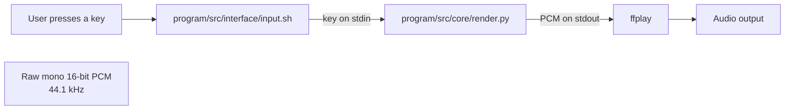

<>
# Audio Signal Processor — Architecture

## Purpose

This document describes the current audio-generation paths in the project. The
application is a learning project for generating and playing audio from Python.

## Current architecture

The current `run` script connects the shell input script, the Python playback
script, and `ffplay` using standard input and output:

### Runtime flow

1. `run` starts the input script, the Python renderer, and `ffplay` as a
   pipeline.
2. `input.sh` reads keys and writes them to standard output.
3. `core/render.py` reads input on a separate thread. A numeric input sets the
   frequency in multiples of 100 Hz; `q` quits.
4. The renderer generates sine-wave samples in chunks and writes signed
   16-bit PCM bytes to standard output.
5. `ffplay` reads the PCM stream as mono audio at 44.1 kHz and plays it.

## Main components

| Component | Responsibility |
|---|---|
| `run` | Activates the Python environment and connects input, rendering, and playback. |
| `program/src/interface/input.sh` | Reads key presses and sends them to the renderer. |
| `program/src/core/render.py` | Generates real-time sine-wave PCM and handles frequency input. |
| `ffplay` | Plays the raw PCM stream. It is an external runtime dependency. |
| `program/src/core/converter.py` | Converts note names and note durations to frequencies and seconds. |
| `program/src/core/calculations.py` | Generates an offline sine wave and converts it to 16-bit PCM bytes. |
| `program/src/core/analysis.py` | Plots a waveform using Matplotlib. |

The converter, offline calculations, and plotting modules are present as
separate capabilities. The current live path through `run` and `core/render.py`
does not call them.

## Interfaces and data

- **Input:** key presses sent as lines of text to the renderer.
- **Audio stream:** signed 16-bit PCM, mono, 44.1 kHz, written to standard
  output.
- **Playback:** `ffplay` is configured to interpret that stream as raw PCM; the
  stream itself does not contain a WAV header.
- **Control:** numeric input changes the generated frequency; `q` exits.

## Dependencies

- Python with NumPy
- `ffplay` (from FFmpeg)
- Bash-compatible shell for the `run` and input scripts

## Current limitations

- The live renderer generates sine waves only.
- The renderer and offline audio modules are not yet integrated.
- Playback depends on an external `ffplay` process.
- The current input script emits a key for each read; the renderer processes
  its input as lines, so input behavior should be checked when changing this
  interface.

## Future changes

Update this document when the live path is integrated with the converter or
offline modules, when new waveform types or controls are added, or when the
audio format or playback approach changes.