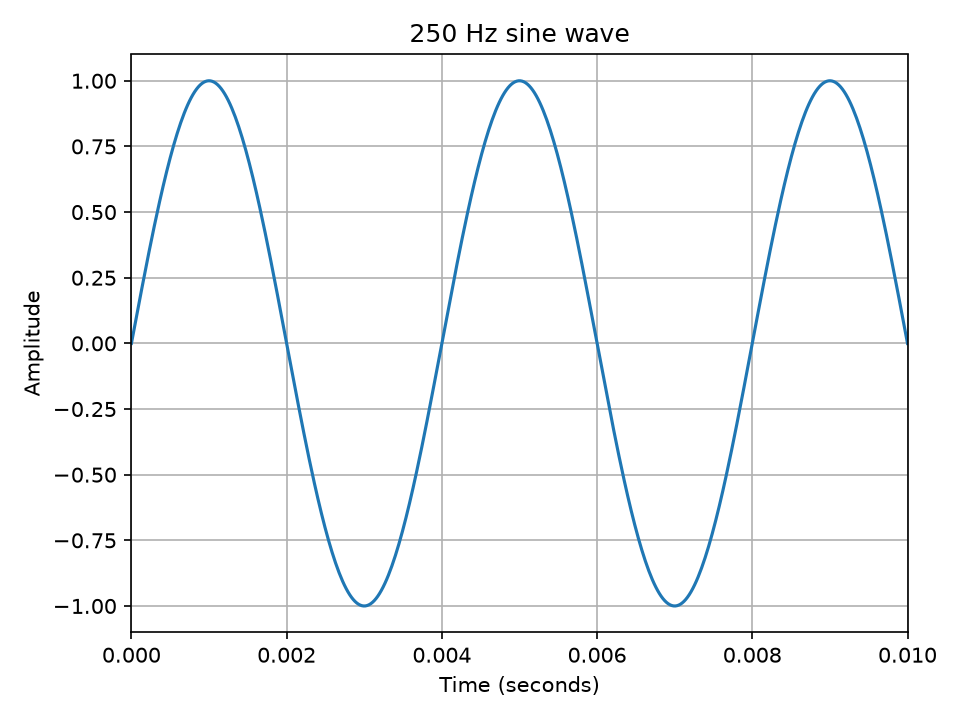

# Test notes

## Purpose
What am I testing?

## Settings
- Frequency:
- Duration:
- Sample rate: 44,100 Hz

## How the code represents the sound
Explain what the code does and how it relates to the wave.

## Graph

## Audio samples
[wave.pcm](wave.pcm)

## Observations
What did I hear or notice?
